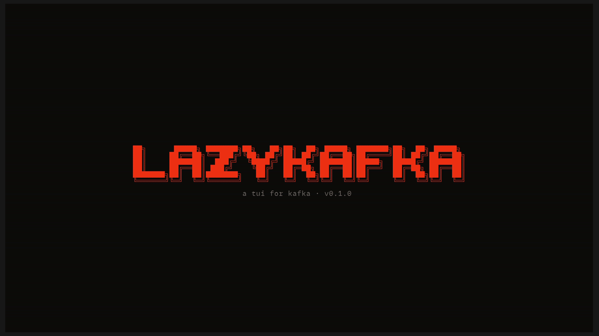

# lazykafka-rs

A tui for Kafka

Currently, it does almost nothing!! It loads a list of topics, lets you browse per partition, look at individual messages with syntax highlighting and jump around through a topic. And thats it. I will be adding many more features in the future. 
